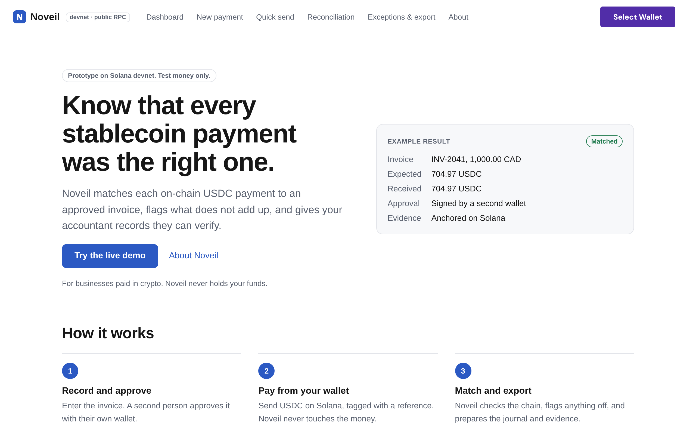
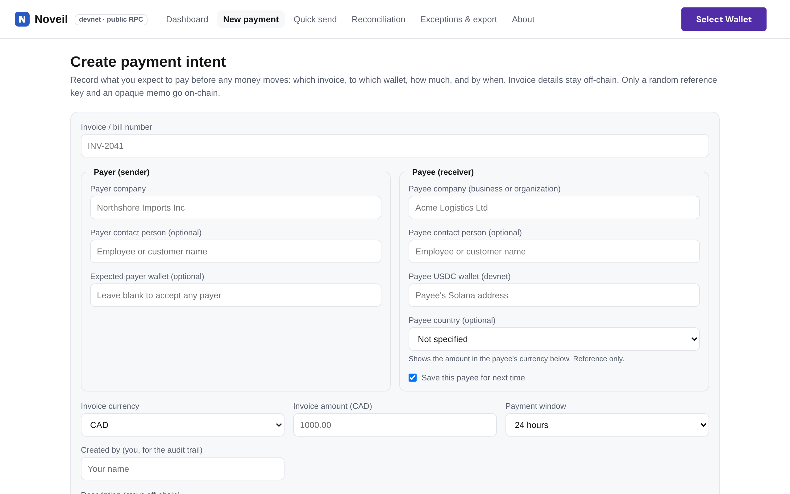
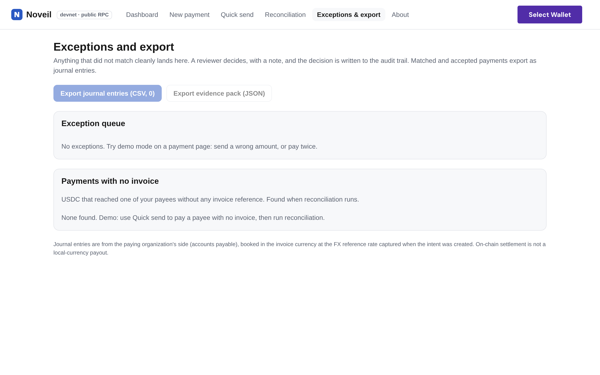

# Noveil: stablecoin payment reconciliation (case study)

**Live demo:** https://noveil.vercel.app (Solana devnet, test money only)
**My role:** lead developer on a team of 3. I designed and built the app end to end.
**Built for:** the Colosseum hackathon, Sep to Oct 2026
**Source code:** private. This repo describes the project; it doesn't contain the code.

## The problem

More businesses get paid in stablecoins like USDC, but the finance side hasn't caught up. A transfer on-chain tells you that money moved. It doesn't tell you which invoice it paid, whether the amount was right, whether anyone approved it, or what to give the accountant. That gap is the same reconciliation problem finance teams already solve for bank feeds, now on a blockchain.

## What Noveil does

1. **Record the invoice.** Invoice number, payer, payee wallet, amount and a payment window. A CAD or USD amount is converted to USDC at a reference rate that's saved with the invoice.
2. **Approve it.** Above a threshold (500 USDC by default), a second person signs an approval with their own wallet. The creator and the payee can't approve their own invoice (maker-checker).
3. **Pay.** The payer sends USDC from their own wallet or a Solana Pay QR code. The transfer carries a random reference key and an opaque memo, so no invoice data goes on-chain.
4. **Match.** Noveil reads the chain, finds every transaction carrying the reference key, and classifies the result as **matched**, **exception** or **needs review**.
5. **Resolve and export.** A reviewer closes each exception with a note. The team exports balanced journal entries (CSV) and a SHA-256-hashed evidence file, and can anchor that hash on Solana to prove later that it wasn't changed.

It flags 14 kinds of problem, including underpaid, overpaid, wrong wallet, wrong token, duplicate, late, paid without approval, unexpected payer, one payment tagged for two invoices, and a full payment from a second wallet. It also finds USDC that reached a payee with no invoice at all.

| New invoice | Exceptions and export |
|---|---|
|  |  |

## Design decisions

| Decision | Why |
|---|---|
| The app never holds funds or keys | Every payment and approval is signed in the user's own wallet. This removes custody risk and most of the regulatory weight. |
| Matching trusts the chain, not the screen | A match needs a successful transaction that moved the exact amount of the official USDC mint to the payee's token account. Browser data can be edited, so nothing security-relevant is trusted from it. |
| Approvals are re-verified, not stored as "approved" | The Ed25519 approval message is rebuilt from the invoice as it is now. If someone changes the invoice after approval, it's caught. |
| A pure `classify()` function decides outcomes | The matching rules can be unit-tested without a network. A version number re-checks old results whenever the rules change. |
| A hash-linked audit trail | Editing an old event breaks the chain and shows as tampered, the same idea as an append-only ledger. |
| A server-side RPC relay | It keeps the RPC key off the browser, allows only a fixed list of methods, and rate-limits by IP. |
| CAD value from the Bank of Canada daily rate | The journal shows the Canadian-dollar value on the settlement day, using whole-cent integer math so entries balance to the cent. |

## How it's built

- **Front end:** Next.js (App Router) and React 19, with the Solana wallet adapter (Phantom, Solflare)
- **Chain:** Solana devnet, USDC (SPL token), Solana Pay. The token instructions are hand-built and checked against the official library.
- **Server:** one route, the RPC relay, on Vercel
- **Storage:** browser storage for the prototype. There's a written plan to move to a hosted database with row-level security and server-side policy.
- **Quality:** 9 automated test suites (reconciliation rules, storage, FX, the relay, routes, docs), ESLint, and CI on every pull request. Weekly Dependabot updates, and a security review with a pre-mainnet checklist.
- **Process:** built with Claude as an AI coding assistant, through pull requests with tests and code review. There has been no outside audit.

## What I'd do next

- Move records to a database, and move the approval threshold and audit trail to the server, so policy can't be changed from a browser.
- Verify the approval signature during reconciliation and export too, not only when a payment is built. This is a known low-risk gap today.
- Go to mainnet: a separate RPC key with usage caps, priority fees, and matching on finalized transactions.
- Support Token-2022 stablecoins such as PYUSD.

## Limits

This is a prototype. It runs on devnet with test money, it isn't audited, and a USDC payment on-chain isn't a payout in local currency. The CAD value is for reference and isn't tax advice.
